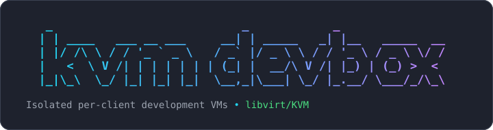
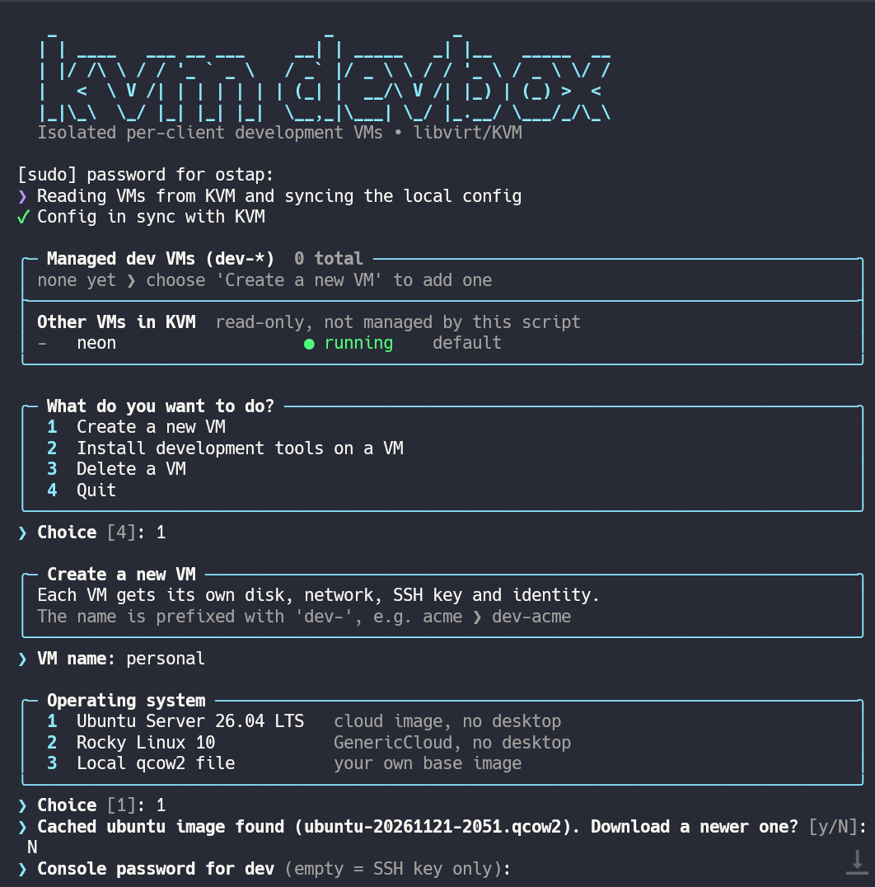
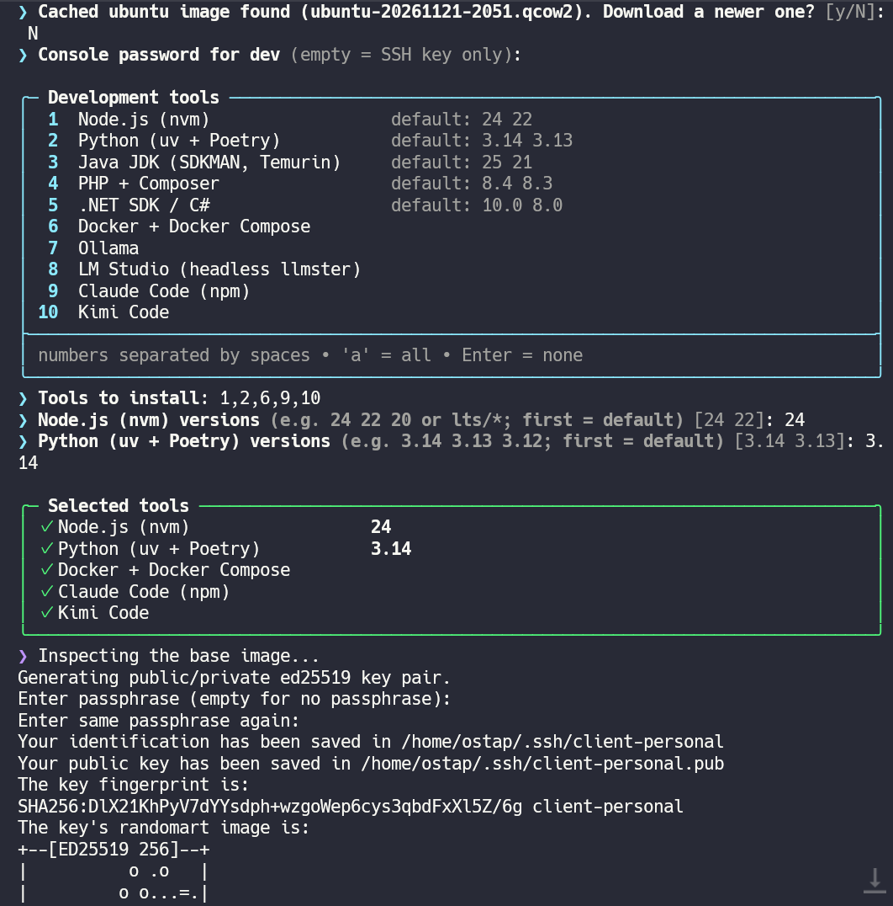
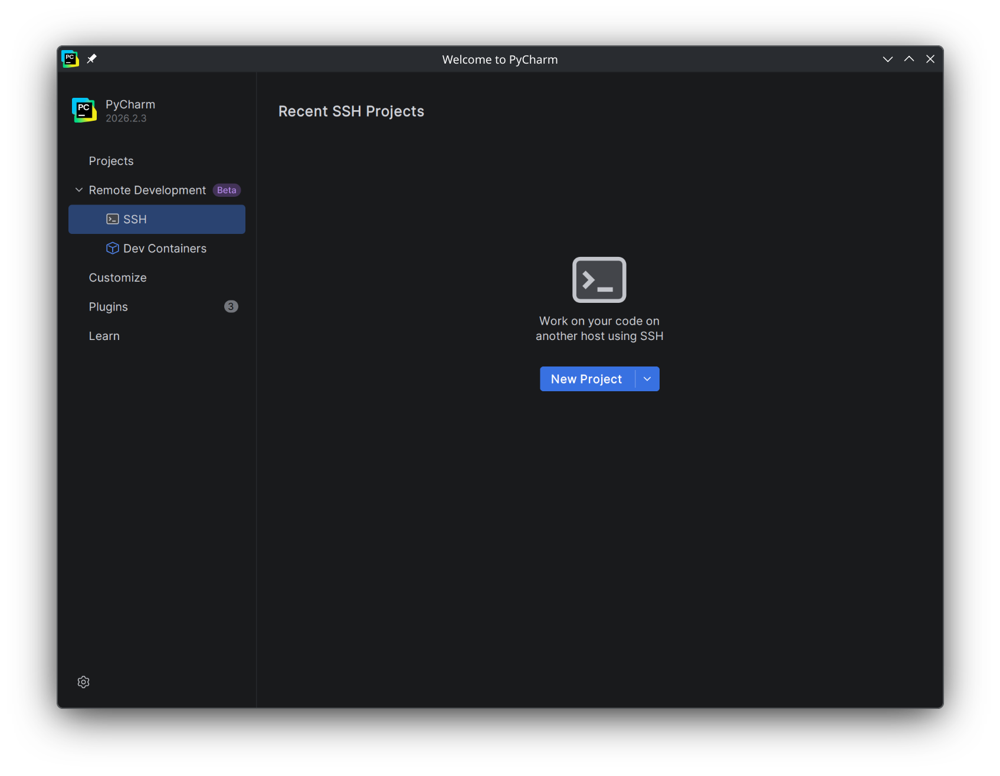
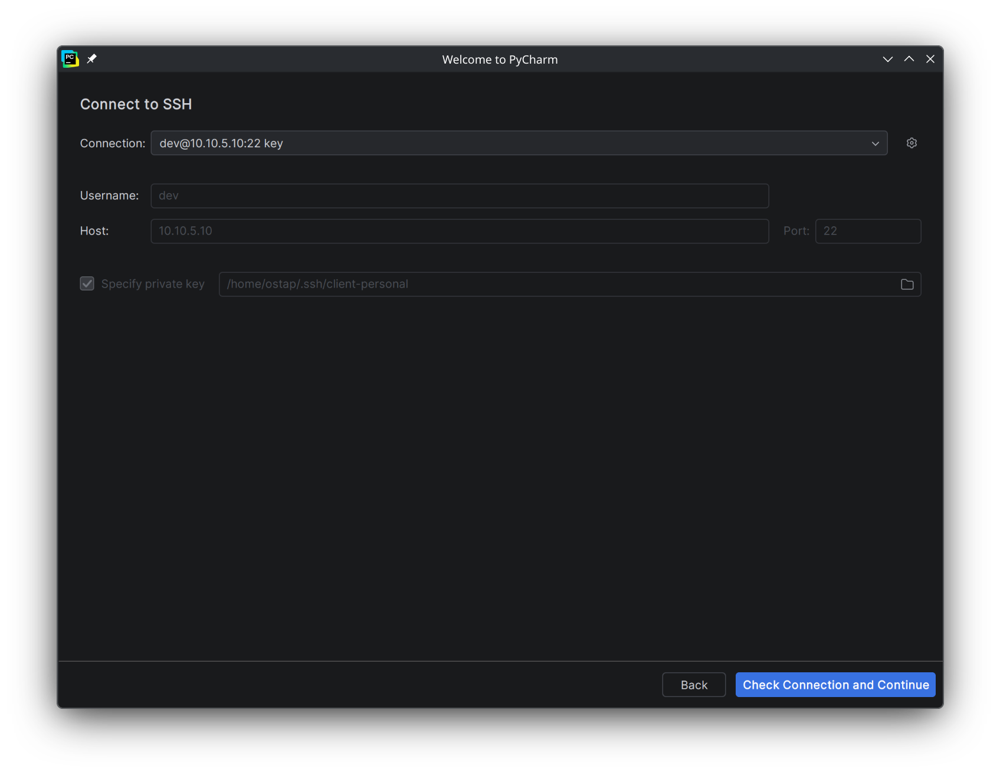
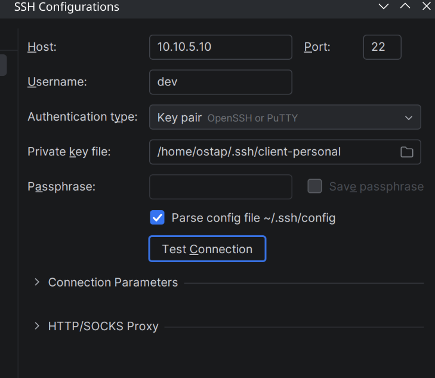

<p align="center">
  
</p>

<h1 align="center">kvm-devbox</h1>

<p align="center">
  <b>Isolated, disposable development VMs — one per client — on libvirt/KVM.</b>
</p>

<p align="center">
  
  
  
  
  
  
</p>

`kvm-devbox.sh` is a single interactive Bash script that creates a VM with its own disk, private network, SSH key and identity, installs the development tools you pick, and wires up `~/.ssh/config` so you can run `ssh dev-<name>` or open the VM straight from a **JetBrains IDE over SSH**.

> [!TIP]
> Three commands to a ready VM: `./kvm-devbox.sh` → pick **1** → `ssh dev-<name>`.

## ✨ Why

- **Client isolation.** Code, credentials, caches and toolchains of one client never touch another's. Each VM sits on its own NAT network (`10.10.N.0/24`) with its own SSH key.
- **Reproducible.** VMs are thin qcow2 overlays on a cached, checksum-verified base image. The base image is never modified.
- **Disposable.** Delete a VM and its disk, network, SSH config entry and (optionally) key are removed in one step.
- **Fast to set up.** No cloud-init: the disk is prepared offline with `virt-customize`, so the VM is reachable over SSH on first boot.

## 📑 Contents

1. [Features](#-features)
2. [Host requirements](#-host-requirements)
3. [Install the host tools](#-1-install-the-host-tools)
4. [Run the script](#-2-run-the-script)
5. [Create a VM (walkthrough)](#-3-create-a-vm-walkthrough)
6. [Development tools catalog](#-development-tools-catalog)
7. [Connect over SSH](#-4-connect-over-ssh)
8. [Develop with JetBrains over SSH](#-5-develop-with-jetbrains-over-ssh)
9. [Managing VMs](#-managing-vms)
10. [Configuration](#-configuration)
11. [How it works](#-how-it-works)
12. [Troubleshooting](#-troubleshooting)

## 🚀 Features

- Ubuntu Server 26.04 LTS or Rocky Linux 10 cloud images, or your own local qcow2 file.
- Image download with SHA-256 verification and a local cache (`/var/lib/libvirt/images/base`).
- Per-VM isolated libvirt NAT network with a fixed IP (`10.10.N.10`).
- Per-VM ed25519 SSH key and an auto-generated `~/.ssh/config` entry.
- Optional console password (empty means SSH key only).
- Interactive tool installer (re-runnable on existing VMs) with per-language version selection.
- Local state in `~/.config/kvm-devbox/config.json`, kept in sync with libvirt on every start.
- UEFI guest support, automatic root-disk growth, passwordless `sudo` for the dev user.

## 🧰 Host requirements

| Requirement | Notes |
|---|---|
| Linux with KVM | `/dev/kvm` must exist (enable VT-x/AMD-V in BIOS). Without it VMs are very slow. |
| Debian/Ubuntu-style host | The install hints use `apt`. Other distros work if you install the equivalent packages. |
| `sudo` rights | The script calls `virsh`, `virt-install`, `qemu-img` and libguestfs through `sudo`. |
| Resources per VM (default) | 4 vCPU, 12 GB RAM, 60 GB disk (thin-provisioned). Adjust in the script's settings block. |
| IDE (optional) | A JetBrains IDE (PyCharm, IntelliJ IDEA, WebStorm, ...) with Remote Development over SSH. |

## 📦 1. Install the host tools

On Ubuntu/Debian:

```bash
sudo apt update
sudo apt install -y \
  qemu-system-x86 qemu-utils \
  libvirt-daemon-system libvirt-clients \
  virtinst \
  libguestfs-tools guestfs-tools \
  ovmf \
  jq curl openssh-client
```

Enable and start libvirt, and make sure the `default` libvirt URI works:

```bash
sudo systemctl enable --now libvirtd
sudo virsh list --all          # should print an (empty) table, no errors
```

Verify KVM acceleration is available:

```bash
ls -l /dev/kvm                 # must exist
sudo apt install -y cpu-checker && sudo kvm-ok
```

What each package is for:

| Package | Provides | Used for |
|---|---|---|
| `qemu-system-x86`, `qemu-utils` | QEMU, `qemu-img` | Running VMs, creating overlay disks |
| `libvirt-daemon-system`, `libvirt-clients` | `libvirtd`, `virsh` | VM and network management |
| `virtinst` | `virt-install` | Defining and booting the VM |
| `libguestfs-tools`, `guestfs-tools` | `virt-customize`, `virt-cat`, `guestfish` | Preparing the guest disk offline (user, SSH, network, hostname) |
| `ovmf` | UEFI firmware | Only needed for UEFI images |
| `jq` | JSON processor | Local config file |
| `curl`, `openssh-client` | `curl`, `ssh`, `scp`, `ssh-keygen` | Image download, provisioning, connections |

The script checks for all required commands at startup and prints the exact `apt install` line if something is missing.

## 🏁 2. Run the script

```bash
git clone <this-repository> kvm-devbox     # or just copy the folder
cd kvm-devbox
chmod +x kvm-devbox.sh
./kvm-devbox.sh
```

You will be asked for your `sudo` password once. The main screen lists the VMs managed by the script (`dev-*`), read-only entries for any other VMs on the host, and the menu:



| Option | Action |
|---|---|
| 1 | Create a new VM |
| 2 | Install development tools on an existing VM |
| 3 | Delete a VM |
| 4 | Quit |

> [!NOTE]
> Set `NO_COLOR=1` to disable colours. The UI falls back to plain ASCII when the locale is not UTF-8.

```bash
./kvm-devbox.sh                 # coloured UI
NO_COLOR=1 ./kvm-devbox.sh      # plain output (logs, CI, screen readers)
LC_ALL=C ./kvm-devbox.sh        # ASCII box drawing
```

## 💻 3. Create a VM (walkthrough)

Choose **1**, then answer the prompts.

1. **VM name.** `personal` becomes `dev-personal`. Allowed: `a-z`, `0-9`, `-` (max 31 chars).
2. **Operating system.**
   - `1` Ubuntu Server 26.04 LTS (cloud image, no desktop)
   - `2` Rocky Linux 10 (GenericCloud, no desktop)
   - `3` Local qcow2 file (your own base image; it must never be booted or modified afterwards)
3. **Base image.** If one is cached you are asked whether to download a newer one. New downloads are checksum-verified.
4. **Console password** for the `dev` user. Leave empty for SSH key only.
5. **Development tools.** Pick by number, space separated (`a` = all, Enter = none), then choose versions.



In the example above, tools `1,2,6,9,10` were chosen: Node.js 24, Python 3.14, Docker, Claude Code and Kimi Code. The script then:

1. generates a dedicated SSH key `~/.ssh/client-<name>` (you can set a passphrase),
2. creates the isolated network `net-<name>` (`10.10.N.0/24`),
3. creates a qcow2 overlay on the base image and prepares it offline,
4. defines and starts the VM,
5. appends a `Host dev-<name>` block to `~/.ssh/config`,
6. waits for SSH and runs the tool installer inside the VM.

When finished a summary shows the SSH command, IP, user and key path:

```diff
+ ✓ Network net-personal created (10.10.5.0/24)
+ ✓ Disk ready: /var/lib/libvirt/images/client-personal.qcow2
+ ✓ VM dev-personal started
+ ✓ SSH is up
+ ✓ Development tools installed on dev-personal
```

```text
╭─ Ready ──────────────────────────────────────────────────────╮
│ ✓ dev-personal is up and running                             │
├──────────────────────────────────────────────────────────────┤
│ SSH         ssh dev-personal                                 │
│ Address     10.10.5.10                                       │
│ User        dev                                              │
│ Key         /home/<you>/.ssh/client-personal                 │
│ OS          ubuntu-26.04                                     │
│ Tools       claude, docker, kimi, node, python               │
├──────────────────────────────────────────────────────────────┤
│ JetBrains Gateway: host dev-personal with 'Parse config ...' │
╰──────────────────────────────────────────────────────────────╯
```

If a tool fails, the provisioning summary shows it in red and the other tools are still installed:

```diff
+ [ok]     Node.js 24 (nvm)
+ [ok]     Python 3.14 (uv + Poetry)
+ [ok]     Docker + Docker Compose
- [failed] Kimi Code
! Re-run option 2 to retry only what is missing.
```

> [!IMPORTANT]
> Option **3** (local qcow2) uses your file as a backing image. Never boot or modify it afterwards, or every VM disk based on it will be corrupted.

## 🔧 Development tools catalog

Selected tools are installed inside the VM for the `dev` user. Each step is independent: a failure in one does not stop the others, and you can re-run option **2** to retry.

| # | Tool | Installed via | Default versions |
|---|---|---|---|
| 1 | Node.js | nvm | `24 22` |
| 2 | Python | uv + Poetry | `3.14 3.13` |
| 3 | Java JDK | SDKMAN (Temurin) | `25 21` |
| 4 | PHP + Composer | ondrej PPA (Ubuntu) / Remi (Rocky) | `8.4 8.3` |
| 5 | .NET SDK / C# | `dotnet-install.sh` | `10.0 8.0` |
| 6 | Docker + Compose | Docker apt/dnf repo | latest |
| 7 | Ollama | official installer | latest |
| 8 | LM Studio (headless `llmster`) | official installer | latest |
| 9 | Claude Code | `npm i -g @anthropic-ai/claude-code` | latest |
| 10 | Kimi Code | official installer | latest |

Notes:

- The first version in a list is the default (`nvm alias default`, `sdk default java`, ...).
- Claude Code needs Node.js; if you pick it without Node.js, the Node LTS is added automatically.
- Ollama and LM Studio run on CPU inside the VM. Raise `MEMORY` in the script (16 GB or more recommended).
- Docker: log out and back in to use `docker` without `sudo`. LM Studio: start the daemon with `lms daemon up`.
- Environment setup lives in `~/.devbox_env`, loaded from `~/.bashrc` and `~/.profile`. Open a new SSH session after installing so `PATH` is refreshed.
- Installed tools are recorded in `~/.devbox_installed` in the VM and in the local config.

## 🔑 4. Connect over SSH

The script creates this entry in `~/.ssh/config`:

```sshconfig
Host dev-personal
    HostName 10.10.5.10
    User dev
    IdentityFile /home/<you>/.ssh/client-personal
    IdentitiesOnly yes
    StrictHostKeyChecking accept-new
```

So connecting is simply:

```bash
ssh dev-personal
```

Useful one-liners:

```bash
ssh dev-personal 'node --version && python --version'   # run a command
scp ./notes.txt dev-personal:~/                          # copy a file in
ssh -L 3000:localhost:3000 dev-personal                  # forward a dev server port
ssh -t dev-personal docker ps                            # needs a TTY
```

With one VM per client, the config file simply grows one block per client:

```sshconfig
Host dev-acme
    HostName 10.10.1.10
    User dev
    IdentityFile ~/.ssh/client-acme
    IdentitiesOnly yes

Host dev-globex
    HostName 10.10.2.10
    User dev
    IdentityFile ~/.ssh/client-globex
    IdentitiesOnly yes
```

Inside the VM everything installed is ready to use, for example Node.js and Claude Code:


## 💡 5. Develop with JetBrains over SSH

JetBrains IDEs run the IDE backend inside the VM and show a thin client on your desktop, so indexing, builds and tooling all happen in the isolated environment. This works with PyCharm, IntelliJ IDEA, WebStorm, PhpStorm, Rider and the others, either from the IDE's welcome screen or from **JetBrains Gateway**.

### Prerequisites

- The VM is running and `ssh dev-<name>` works from a terminal.
- At least 4 GB of free RAM inside the VM for the IDE backend (the default 12 GB is plenty).

### Steps

**a) Open Remote Development → SSH.** On the welcome screen choose *Remote Development → SSH* and click **New Project**.



**b) Create the SSH connection.** Click the gear / *New Connection* and fill in the VM details. The values come from the "Ready" summary shown by the script (or from `~/.ssh/config`):

| Field | Value |
|---|---|
| Host | `10.10.5.10` (the VM IP, `10.10.N.10`) |
| Port | `22` |
| Username | `dev` |
| Authentication type | Key pair (OpenSSH or PuTTY) |
| Private key file | `~/.ssh/client-<name>` |
| Parse config file `~/.ssh/config` | enabled |

Click **Test Connection** to verify.



> [!TIP]
> With *Parse config file ~/.ssh/config* enabled you can instead enter the host alias `dev-<name>` and the IDE picks up the user, address and key automatically.

**c) Check the connection.** Select the connection (`dev@10.10.5.10:22 key`) and click **Check Connection and Continue**.



**d) Pick the IDE and project folder.** Choose the IDE version to download into the VM and the project directory (for example `/home/dev/project`), then click **Download IDE and Connect**. The IDE opens as a thin client connected to the VM.

> [!NOTE]
> The IDE backend is downloaded inside the VM on first use, so the VM needs internet access. This works out of the box, since the VM network is NAT.

### Using the toolchains from the IDE

Everything is installed under the `dev` user's home, so point the IDE at it:

| Tool | Path inside the VM |
|---|---|
| Python (uv) | `~/.local/bin/python`, uv-managed versions under `~/.local/share/uv/python` |
| Node.js (nvm) | `~/.nvm/versions/node/<version>/bin/node` |
| Java (SDKMAN) | `~/.sdkman/candidates/java/<version>` |
| .NET | `~/.dotnet` |
| PHP | `/usr/bin/php<version>` or `/usr/local/bin/php` |
| Docker | `/var/run/docker.sock` (log out/in after install) |

## 📋 Managing VMs

| Task | How |
|---|---|
| List VMs | Run the script; the table shows name, subnet `N`, IP, OS and state |
| Add or update tools | Option **2**, pick the VM, pick tools (already installed tools are shown) |
| Delete a VM | Option **3**, type the VM name to confirm. Removes the VM (and NVRAM), its `client-<name>.qcow2` disk, the network, the SSH config entry and known_hosts entry; asks before deleting the SSH key. Base images are never deleted |
| Start / stop | `sudo virsh start dev-<name>` / `sudo virsh shutdown dev-<name>` |
| Console | `sudo virsh console dev-<name>` (needs a console password) |

```bash
sudo virsh start dev-personal        # power on
sudo virsh shutdown dev-personal     # clean shutdown
sudo virsh console dev-personal      # serial console (exit with Ctrl+])
sudo virsh net-list --all            # one net-<name> per VM
```

VMs created or removed outside the script are detected on the next run and the local config is updated. VMs without the `dev-` prefix are shown read-only and are never touched.

Deleting asks you to type the VM name, then removes everything it created:

```diff
- VM       dev-personal
- Disk     /var/lib/libvirt/images/client-personal.qcow2
- Network  net-personal
- SSH      'dev-personal' entry in ~/.ssh/config
```

## 🔩 Configuration

Edit the settings block at the top of `kvm-devbox.sh`:

| Variable | Default | Meaning |
|---|---|---|
| `PREFIX` | `dev-` | Only VMs with this prefix are managed |
| `IMG_DIR` | `/var/lib/libvirt/images` | Where VM disks live |
| `BASE_DIR` | `$IMG_DIR/base` | Cached base images |
| `SUBNET_PREFIX` | `10.10` | Networks are `10.10.N.0/24`, VM at `.10` |
| `MEMORY` | `12288` | RAM per VM in MB |
| `VCPUS` | `4` | vCPUs per VM |
| `DISK_SIZE` | `60G` | Virtual disk size for cloud images |
| `CLOUD_USER` | `dev` | User created in cloud images |

Example override (for heavier workloads such as local LLMs):

```diff
 PREFIX="dev-"
-MEMORY=12288
+MEMORY=24576
-VCPUS=4
+VCPUS=8
-DISK_SIZE=60G
+DISK_SIZE=120G
```

State files:

- `~/.config/kvm-devbox/config.json`: VM inventory (if corrupted, delete it; it is rebuilt from KVM).
- `~/.ssh/client-<name>[.pub]`: per-VM SSH key.
- `/var/lib/libvirt/images/client-<name>.qcow2`: per-VM disk.

Example `~/.config/kvm-devbox/config.json`:

```json
{
  "last_n": 5,
  "vms": {
    "dev-personal": {
      "network": "net-personal",
      "n": 5,
      "ip": "10.10.5.10",
      "os": "ubuntu-26.04",
      "user": "dev",
      "tools": { "node": "24", "python": "3.14", "docker": "yes", "claude": "yes" }
    }
  },
  "unmanaged": ["neon"]
}
```

## 🔬 How it works

```
 base image (read-only, cached)          /var/lib/libvirt/images/base/ubuntu-YYYYMMDD-HHMM.qcow2
        ▲  backing file
 client overlay (thin qcow2)             /var/lib/libvirt/images/client-<name>.qcow2
        ▲
 libvirt VM  dev-<name>  ── virtio NIC ──►  net-<name>  10.10.N.0/24 (NAT)  ──► internet
                                              └── VM: 10.10.N.10 (static DHCP lease by MAC)
```

1. `virt-customize` edits the overlay offline: hostname, new SSH host keys, `dev` user with passwordless sudo, injected public key, DHCP network config, `sshd`, disk growth, SELinux relabel.
2. `virt-install --import` boots it. There is no cloud-init, so first boot is fast.
3. A provisioning script is copied over SSH and run in the VM to install the chosen tools.

## 🩺 Troubleshooting

| Problem | Fix |
|---|---|
| `missing commands: ...` | Install the packages from [step 1](#-1-install-the-host-tools). |
| `/dev/kvm not found` | Enable virtualization in BIOS/UEFI; check `lsmod \| grep kvm`. |
| `UEFI image: install the firmware` | `sudo apt install ovmf` |
| `SSH on dev-... did not come up within 3 minutes` | Check `sudo virsh list --all` and `sudo virsh console dev-<name>`; make sure `libvirtd` and the network (`sudo virsh net-list --all`) are active. |
| `Host key verification failed` after recreating a VM | `ssh-keygen -R 10.10.N.10` (the script does this on create/delete). |
| libguestfs errors about the kernel | Run the script as intended (libguestfs runs under `sudo`); on Ubuntu hosts `/boot/vmlinuz-*` must be readable by root, which it is by default. |
| Some tools fail to install | Read the summary at the end of provisioning, then run option **2** again to retry. |
| `docker: permission denied` | Log out and back in so the `docker` group applies. |
| JetBrains cannot connect | Confirm `ssh dev-<name>` works in a terminal, the key path is correct, and the VM has internet access for the IDE backend download. |

## 📄 License

Open source. Add your license here.
